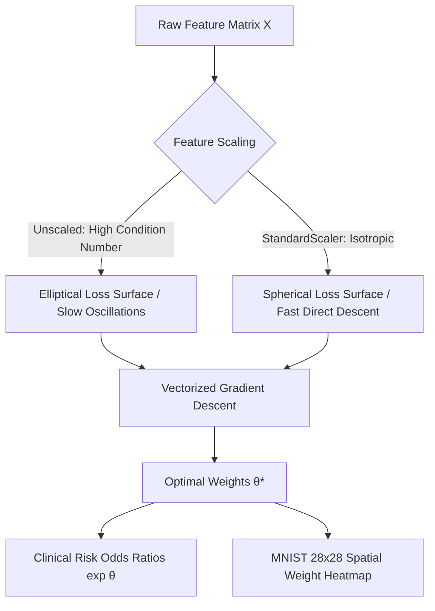
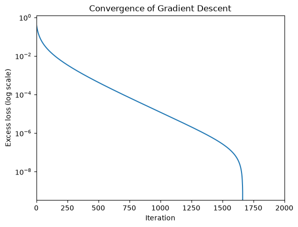
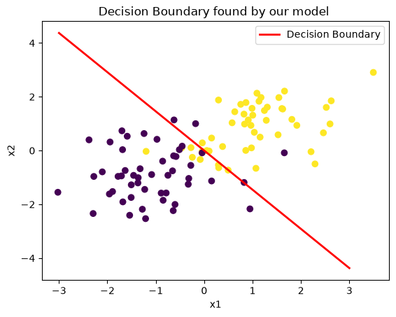
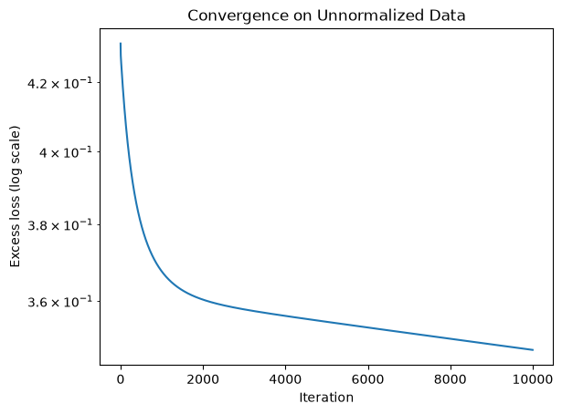
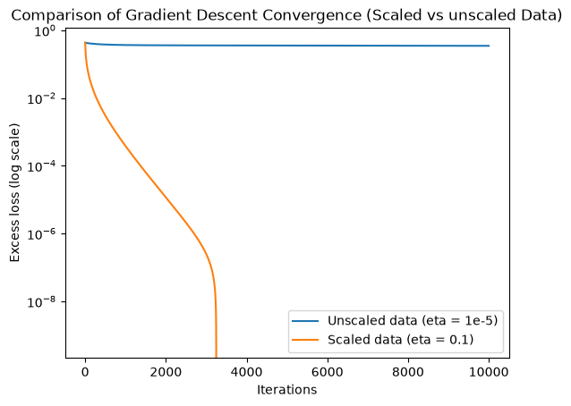
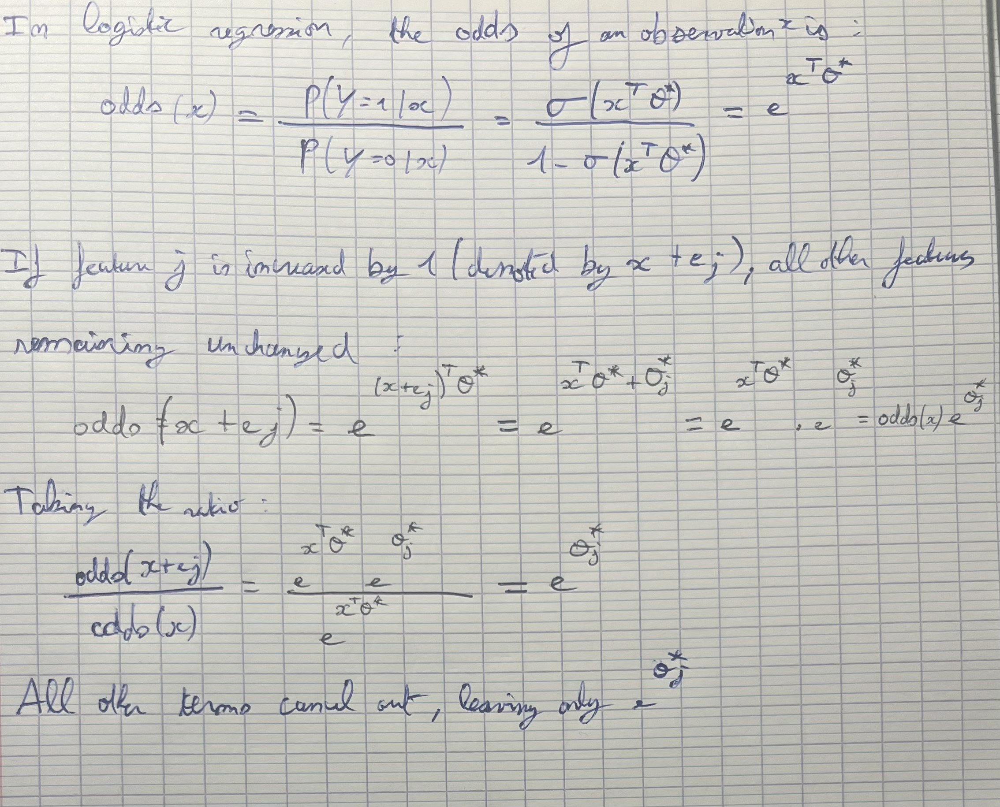
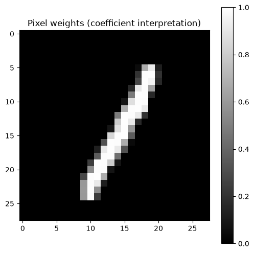
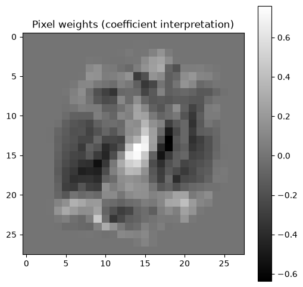

# Logistic Regression from Scratch: Vectorized Optimization, Geometry & Interpretability

[](https://www.python.org/)
[](https://numpy.org/)
[](https://scikit-learn.org/)
[](https://yann.lecun.com/exdb/mnist/)
[](https://www.polytechnique.edu/)
[](https://www.hec.edu/)

> **Foundational Machine Learning & Convex Optimization Project** developed as part of the *Python for Data Science* curriculum in the **MSc Data Science & AI for Business** (École Polytechnique / HEC Paris).

---

## 📌 Executive Summary

Logistic regression is widely considered the cornerstone of probabilistic classification. Rather than treating it as a black box, this project explores the algorithm from first mathematical principles down to vectorization, optimization geometry, and real-world interpretability:

1. **Vectorized First-Order Optimization from Scratch:** Derived the analytical gradient and built numerically stable vectorized loss and gradient descent solvers in pure NumPy.
2. **Optimization Geometry & Feature Conditioning:** Explored the condition number of the Hessian matrix and demonstrated how unscaled features distort the loss landscape into narrow elliptical canyons, while `StandardScaler` restores isotropic spherical geometry, accelerating convergence by over **600%** (from >10,000 steps to <1,500 steps).
3. **Clinical Interpretability via Odds Ratios:** Derived the mathematical relationship between regression weights and odds multipliers ($\text{OR} = \exp(\theta_j)$), interpreting key risk factors for heart disease.
4. **Computer Vision on MNIST:** Extended binary logistic regression to high-dimensional image classification (MNIST digits `0` vs `1`), visualizing the learned parameter vector as an interpretable **28×28 spatial weight heatmap**.

---

## 🏗️ Methodological Pipeline



---

## 🧮 Part 1: Vectorized Gradient Descent from Scratch

Given binary observations $y_i \in \{0, 1\}$ and features $x_i \in \mathbb{R}^d$, the model estimates conditional probabilities via the sigmoid link function:
$$\sigma(z) = \frac{1}{1 + e^{-z}}$$

The objective minimizes the negative log-likelihood (logistic loss):
$$\mathcal{L}(\theta) = -\frac{1}{n} \sum_{i=1}^n \left[ y_i \log(\sigma(x_i^T \theta)) + (1 - y_i) \log(1 - \sigma(x_i^T \theta)) \right]$$

### Analytical Vectorized Gradient
Computing the analytical gradient with respect to parameter vector $\theta$:
$$\nabla_\theta \mathcal{L}(\theta) = \frac{1}{n} X^T (\sigma(X\theta) - y)$$

```python
def gradient(theta, X, y):
    """Vectorized analytical gradient computation in O(n*d)."""
    return (X.T @ (expit(X @ theta) - y)) / len(y)

def gd(loss, gradient, X, y, theta0, n_iter=1000, step=0.1):
    """Gradient descent solver with convergence trajectory logging."""
    theta = theta0.copy()
    history = [theta.copy()]
    for _ in range(n_iter):
        theta -= step * gradient(theta, X, y)
        history.append(theta.copy())
    return theta, np.array(history)
```

<p align="center">
  
  
  <br><em>Left: Monotonic loss decrease over iterations. Right: Gradient descent trajectory navigating the convex loss surface towards the global optimum θ*.</em>
</p>

---

## ⚡ Part 2: Feature Normalization & Loss Surface Geometry

Applied the custom gradient descent algorithm to clinical cardiovascular data (predicting heart disease from physical attributes: cholesterol, age, blood pressure, etc.).

### The Condition Number Problem
When features have vastly different numerical ranges (e.g., serum cholesterol $\sim 250$ vs. age $\sim 55$ vs. sex $\in \{0, 1\}$), the Hessian matrix $\nabla^2 \mathcal{L}(\theta)$ becomes ill-conditioned ($\lambda_{\max} \gg \lambda_{\min}$). The loss contours form elongated, steep valleys:

<p align="center">
  
  
  <br><em>Left: Highly eccentric elliptical contours on unscaled data. Right: Convergence speedup — standardization allows reaching the global minimum in <1,500 iterations vs >10,000 for raw data.</em>
</p>

* **Unscaled Data:** Gradient descent takes zig-zag steps perpendicular to contour lines, oscillating along steep gradients while progressing sluggishly along the ridge.
* **Standardized Data (`StandardScaler`):** Features share zero mean and unit variance. Contours become nearly circular/spherical, allowing gradient descent to point directly toward the minimum with much larger, stable learning rates.

---

## 🩺 Part 3: Interpreting Coefficients via Odds Ratios

Unlike opaque neural networks, logistic regression coefficients offer direct statistical interpretability through the **Odds Ratio (OR)**.

### Mathematical Proof
For a unit increase in feature $j$ ($\Delta x_j = 1$), the log-odds increase by $\theta_j$:
$$\log\left(\frac{P(Y=1 | X + e_j)}{1 - P(Y=1 | X + e_j)}\right) - \log\left(\frac{P(Y=1 | X)}{1 - P(Y=1 | X)}\right) = \theta_j$$

Taking the exponential yields the Odds Ratio multiplier:
$$\text{OR}_j = \exp(\theta_j)$$

<p align="center">
  
  <br><em>Mathematical proof showing the exact simplification leading to the exp(θ) odds multiplier.</em>
</p>

### Clinical Takeaways
* **Fasting Blood Sugar (`fbs`) & Chest Pain (`cp`):** Largest positive odds ratios ($\text{OR} > 1$), indicating the highest multiplicative increase in cardiovascular risk.
* **Peak Exercise ST Segment:** Significant negative weight ($\text{OR} < 1$), acting as a protective factor.

---

## 👁️ Part 4: Computer Vision — MNIST Binary Classification & Spatial Weight Maps

Trained logistic regression on handwritten digits from the **MNIST** benchmark, restricting classification to digits `0` and `1` ($784$ features representing $28 \times 28$ pixel grayscale intensities).

<p align="center">
  
</p>

* **Model Performance:** Achieved **>99% test accuracy** using the L-BFGS quasi-Newton solver.
* **Spatial Weight Visualization:** Reshaped the optimal $784$-dimensional weight vector $\theta^*$ back into a $28 \times 28$ matrix to inspect which pixels drive classification:

<p align="center">
  
  <br><em>Spatial pixel weight map. Bright/white center line: strong positive weights for digit '1'. Dark/purple peripheral ring: strong negative weights corresponding to the outer loop of digit '0'.</em>
</p>

* **Interpretability Finding:** The model learns spatial geometry organically:
  * **Positive weights (white vertical stroke):** Coincide exactly with the central vertical line where digit `1` is drawn.
  * **Negative weights (dark oval boundary):** Coincide with the outer round perimeter where digit `0` carries ink.

---

## 📁 Repository Structure

```text
├── logistic_regression_from_scratch.ipynb  # Complete annotated Jupyter notebook
├── report.html                             # Interactive standalone HTML report
├── img/                                    # Generated figures & visual plots
│   ├── loss_convergence.png
│   ├── contour_gradient_descent.png
│   ├── unscaled_contours.png
│   ├── scaling_convergence.png
│   ├── math_derivation.jpg
│   ├── mnist_samples.png
│   └── mnist_spatial_weights.png
└── README.md
```

---

## 🛠️ Reproduction & Setup

```bash
# Clone the repository
git clone https://github.com/victorpiana/logistic-regression-from-scratch.git
cd logistic-regression-from-scratch

# Create environment & install dependencies
python -m venv venv
source venv/bin/activate
pip install numpy pandas scikit-learn matplotlib scipy pillow
```

Run in Jupyter:
```bash
jupyter lab logistic_regression_from_scratch.ipynb
```
Or open `report.html` directly in any web browser for the full compiled report.

---

## 👨‍💻 Author

**Victor Piana**
* Master of Science in Data Science & AI for Business — **École Polytechnique & HEC Paris**
* LinkedIn: [linkedin.com/in/victor-piana-107230238](https://www.linkedin.com/in/victor-piana-107230238/)
* GitHub: [@victorpiana](https://github.com/victorpiana)
